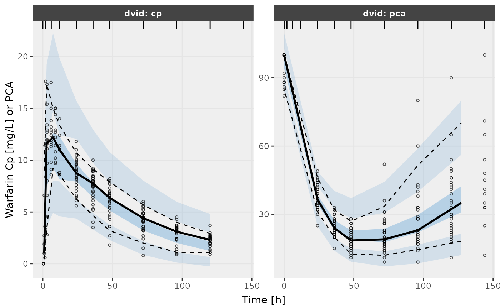
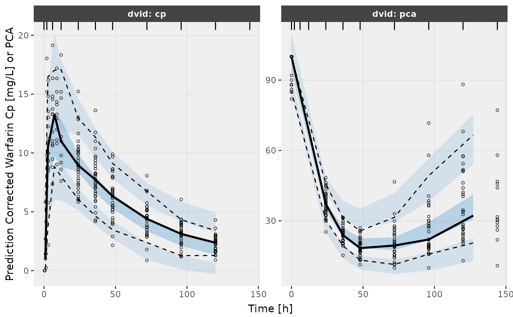

# Running NONMEM with nlmixr2

``` r

library(babelmixr2)
```

## Step 0: What do you need to do to have `nlmixr2` run `NONMEM` from a nlmixr2 model

To use `NONMEM` in nlmixr, you do not need to change your data or your
`nlmixr2` dataset. `babelmixr2` will do the heavy lifting here.

You do need to setup how to run `NONMEM`. For many cases this is easy;
You simply have to figure out the command to run `NONMEM` (it is often
useful to use the full command path). You can set it in
`options("babelmixr2.nonmem"="nmfe743")` or use
`nonmemControl(runCommand="nmfe743")`. I prefer the
[`options()`](https://rdrr.io/r/base/options.html) method since you only
need to set it once. This could also be a function if you prefer (but I
will not cover using the function here).

## Step 1: Run a `nlmixr2` in NONMEM

Lets take the classic warfarin example to start the comparison.

The model we use in the `nlmixr2` vignettes is:

``` r

library(babelmixr2)
pk.turnover.emax3 <- function() {
  ini({
    tktr <- log(1)
    tka <- log(1)
    tcl <- log(0.1)
    tv <- log(10)
    ##
    eta.ktr ~ 1
    eta.ka ~ 1
    eta.cl ~ 2
    eta.v ~ 1
    prop.err <- 0.1
    pkadd.err <- 0.1
    ##
    temax <- logit(0.8)
    tec50 <- log(0.5)
    tkout <- log(0.05)
    te0 <- log(100)
    ##
    eta.emax ~ .5
    eta.ec50  ~ .5
    eta.kout ~ .5
    eta.e0 ~ .5
    ##
    pdadd.err <- 10
  })
  model({
    ktr <- exp(tktr + eta.ktr)
    ka <- exp(tka + eta.ka)
    cl <- exp(tcl + eta.cl)
    v <- exp(tv + eta.v)
    emax = expit(temax+eta.emax)
    ec50 =  exp(tec50 + eta.ec50)
    kout = exp(tkout + eta.kout)
    e0 = exp(te0 + eta.e0)
    ##
    DCP = center/v
    PD=1-emax*DCP/(ec50+DCP)
    ##
    effect(0) = e0
    kin = e0*kout
    ##
    d/dt(depot) = -ktr * depot
    d/dt(gut) =  ktr * depot -ka * gut
    d/dt(center) =  ka * gut - cl / v * center
    d/dt(effect) = kin*PD -kout*effect
    ##
    cp = center / v
    cp ~ prop(prop.err) + add(pkadd.err)
    effect ~ add(pdadd.err) | pca
  })
}
```

Now you can run the `nlmixr2` model using `NONMEM` you simply can run it
directly:

``` r

try(nlmixr(pk.turnover.emax3, nlmixr2data::warfarin, "nonmem",
           nonmemControl(readRounding=FALSE, modelName="pk.turnover.emax3")),
    silent=TRUE)
#> ℹ parameter labels from comments are typically ignored in non-interactive mode
#> ℹ Need to run with the source intact to parse comments
#> → loading into symengine environment...
#> → pruning branches (`if`/`else`) of full model...
#> ✔ done
#> 
#> 
#>  WARNINGS AND ERRORS (IF ANY) FOR PROBLEM    1
#> 
#>  (WARNING  2) NM-TRAN INFERS THAT THE DATA ARE POPULATION.
#> 
#> 
#> 0MINIMIZATION TERMINATED
#>  DUE TO ROUNDING ERRORS (ERROR=134)
#>  NO. OF FUNCTION EVALUATIONS USED:     1088
#>  NO. OF SIG. DIGITS UNREPORTABLE
#> 0PARAMETER ESTIMATE IS NEAR ITS BOUNDARY
#> 
#> nonmem model: 'pk.turnover.emax3-nonmem/pk.turnover.emax3.nmctl'
#> → terminated with rounding errors, can force nlmixr2/rxode2 to read with nonmemControl(readRounding=TRUE)
```

That this is the same way you would run an ordinary `nlmixr2` model, but
it is simply a new estimation method `"nonmem"` with a new controller
([`nonmemControl()`](https://nlmixr2.github.io/babelmixr2/reference/nonmemControl.md))
to setup options for estimation.

A few options in the
[`nonmemControl()`](https://nlmixr2.github.io/babelmixr2/reference/nonmemControl.md)
here is `modelName` which helps control the output directory of `NONMEM`
(if not specified `babelmixr2` tries to guess based on the model name
based on the input).

If you try this yourself, you see that `NONMEM` fails with rounding
errors. You could do the standard approach of changing `sigdig`, `sigl`,
`tol` etc, to get a successful `NONMEM` model convergence, of course
that is supported. But with `babelmixr2` you can *do more*.

## Optional Step 2: Recover a failed NONMEM run

One of the other approaches is to **ignore** the rounding errors that
have occurred and read into `nlmixr2` anyway:

``` r

# Can still load the model to get information (possibly pipe) and create a new model
f <- nlmixr(pk.turnover.emax3, nlmixr2data::warfarin, "nonmem",
            nonmemControl(readRounding=TRUE, modelName="pk.turnover.emax3"))
#> ℹ parameter labels from comments are typically ignored in non-interactive mode
#> ℹ Need to run with the source intact to parse comments
#> → loading into symengine environment...
#> → pruning branches (`if`/`else`) of full model...
#> ✔ done
#> → loading into symengine environment...
#> → pruning branches (`if`/`else`) of full model...
#> ✔ done
#> → finding duplicate expressions in EBE model...
#> → compiling EBE model...
#> ✔ done
#> rxode2 5.1.8 using 2 threads (see ?getRxThreads)
#>   no cache: create with `rxCreateCache()`
#> → Calculating residuals/tables
#> ✔ done
#> → compress origData in nlmixr2 object, save 27800
#> → compress parHistData in nlmixr2 object, save 5048
```

You may see more work happening than you expected to need for an already
completed model. When reading in a NONMEM model, `babelmixr2` grabs:

- `NONMEM`’s objective function value
- `NONMEM`’s covariance (if available)
- `NONMEM`’s optimization history
- `NONMEM`’s final parameter estimates (including the ETAs)
- `NONMEM`’s `PRED` and `IPRED` values (for validation purposes)

These are used to solve the ODEs *as if they came from an nlmixr2*
optimization procedure.

This means that you can compare the `IPRED` and `PRED` values of
`nlmixr2`/`rxode2` and *know immediately* if your model validates.

This is similar to the procedure Kyle Baron advocates for validating a
NONMEM model against a `mrgsolve` model (see
<https://mrgsolve.org/blog/posts/2022-05-validate-translation/> and
<https://mrgsolve.org/blog/posts/2023-update-validation.html>),

The advantage of this method is that you need to simply write one model
to get a validated `roxde2`/`nlmixr2` model.

In this case you can see the validation when you print the fit object:

``` r

print(f)
#> ── nlmixr² nonmem ver 7.4.3 ──
#> 
#>                 OBJF      AIC      BIC Log-likelihood Condition#(Cov)
#> nonmem focei 1326.91 2252.605 2332.025      -1107.302              NA
#>              Condition#(Cor)
#> nonmem focei              NA
#> 
#> ── Time (sec $time): ──
#> 
#>             setup preprocess postprocess table compress NONMEM
#> elapsed 0.8659589      0.036       0.027 0.053    0.016 320.27
#> 
#> ── Population Parameters ($parFixed or $parFixedDf): ──
#> 
#>               Est. SE %RSE Back-transformed(95%CI) BSV(CV% or SD) Shrink(SD)%
#> tktr       6.24e-7                            1.00           86.5       59.8 
#> tka       -3.01e-6                            1.00           86.5       59.8 
#> tcl          -2.00                           0.135           28.6       1.34 
#> tv            2.05                            7.78           22.8       6.44 
#> prop.err    0.0986                          0.0986                           
#> pkadd.err    0.512                           0.512                           
#> temax         6.42                           0.998        0.00707        100 
#> tec50        0.141                            1.15           45.0       6.06 
#> tkout        -2.95                          0.0522           9.16       32.4 
#> te0           4.57                            96.6           5.24       18.1 
#> pdadd.err     3.72                            3.72                           
#>  
#>   No correlations in between subject variability (BSV) matrix
#>   Full BSV covariance ($omega) or correlation ($omegaR; diagonals=SDs) 
#>   Distribution stats (mean/skewness/kurtosis/p-value) available in $shrink 
#>   Information about run found ($runInfo):
#>    • NONMEM terminated due to rounding errors, but reading into nlmixr2/rxode2 anyway 
#>   Censoring ($censInformation): No censoring
#>   Minimization message ($message):  
#>     
#> 
#>  WARNINGS AND ERRORS (IF ANY) FOR PROBLEM    1
#> 
#>  (WARNING  2) NM-TRAN INFERS THAT THE DATA ARE POPULATION.
#> 
#>     
#> 0MINIMIZATION TERMINATED
#>  DUE TO ROUNDING ERRORS (ERROR=134)
#>  NO. OF FUNCTION EVALUATIONS USED:     1088
#>  NO. OF SIG. DIGITS UNREPORTABLE
#> 0PARAMETER ESTIMATE IS NEAR ITS BOUNDARY
#> 
#>     IPRED relative difference compared to Nonmem IPRED: 0%; 95% percentile: (0%,0%); rtol=6.36e-06
#>     PRED relative difference compared to Nonmem PRED: 0%; 95% percentile: (0%,0%); rtol=6.08e-06
#>     IPRED absolute difference compared to Nonmem IPRED: 95% percentile: (2.53e-06, 0.000502); atol=7.15e-05
#>     PRED absolute difference compared to Nonmem PRED: 95% percentile: (3.79e-07,0.00321); atol=6.08e-06
#>     there are solving errors during optimization (see '$prderr')
#>     nonmem model: 'pk.turnover.emax3-nonmem/pk.turnover.emax3.nmctl' 
#> 
#> ── Fit Data (object is a modified tibble): ──
#> # A tibble: 483 × 35
#>   ID     TIME CMT      DV  PRED   RES IPRED   IRES  IWRES eta.ktr eta.ka eta.cl
#>   <fct> <dbl> <fct> <dbl> <dbl> <dbl> <dbl>  <dbl>  <dbl>   <dbl>  <dbl>  <dbl>
#> 1 1       0.5 cp      0    1.16 -1.16 0.444 -0.444 -0.864  -0.506 -0.506  0.699
#> 2 1       1   cp      1.9  3.37 -1.47 1.45   0.446  0.840  -0.506 -0.506  0.699
#> 3 1       2   cp      3.3  7.51 -4.21 3.96  -0.660 -1.03   -0.506 -0.506  0.699
#> # ℹ 480 more rows
#> # ℹ 23 more variables: eta.v <dbl>, eta.emax <dbl>, eta.ec50 <dbl>,
#> #   eta.kout <dbl>, eta.e0 <dbl>, cp <dbl>, depot <dbl>, gut <dbl>,
#> #   center <dbl>, effect <dbl>, ktr <dbl>, ka <dbl>, cl <dbl>, v <dbl>,
#> #   emax <dbl>, ec50 <dbl>, kout <dbl>, e0 <dbl>, DCP <dbl>, PD <dbl>,
#> #   kin <dbl>, tad <dbl>, dosenum <dbl>
```

Which shows the `preds` and `ipreds` match between `NONMEM` and
`nlmixr2` quite well.

## Optional Step 3: Use `nlmixr2` to help understand why `NONMEM` failed

Since it *is* a `nlmixr2` fit, you can do interesting things with this
fit that you couldn’t do in `NONMEM` or even in another translator. For
example, if you wanted to add a covariance step you can with
[`getVarCov()`](https://rdrr.io/pkg/nlme/man/getVarCov.html):

``` r

getVarCov(f)
#> → loading into symengine environment...
#> → pruning branches (`if`/`else`) of full model...
#> ✔ done
#> [====|====|====|====|====|====|====|====|====|====] 0:00:00
#> → calculate sensitivities
#> [====|====|====|====|====|====|====|====|====|====] 0:00:00
#> → calculate ∂(f)/∂(η)
#> [====|====|====|====|====|====|====|====|====|====] 0:00:00
#> → finding duplicate expressions in inner model...
#> → finding duplicate expressions in EBE model...
#> → compiling inner model...
#> ✔ done
#> → finding duplicate expressions in FD model...
#> → compiling EBE model...
#> ✔ done
#> → compiling events FD model...
#> ✔ done
#> calculating covariance matrix
#> [====|====|====|====|====|====|====|====|====|====] 0:05:09
#> Warning: "r,s" not usable (S not PD); installed "r"
#> → compress origData in nlmixr2 object, save 27800
#> Updated original fit object f
#>                      tktr           tka           tcl            tv
#> tktr         1.097970e-01  1.097480e-01  6.688347e-03 -1.366009e-02
#> tka          1.097480e-01  1.097018e-01  6.689857e-03 -1.364775e-02
#> tcl          6.688347e-03  6.689857e-03  3.369367e-03 -1.493626e-04
#> tv          -1.366009e-02 -1.364775e-02 -1.493626e-04  3.384224e-03
#> prop.err     7.120345e-03  7.122223e-03  6.924161e-04 -9.877428e-04
#> pkadd.err   -6.216902e-02 -6.223760e-02 -4.113834e-03  6.823692e-03
#> temax        6.366671e-02  6.379341e-02  1.143648e-04 -1.022260e-02
#> tec50       -1.647436e-03 -1.645059e-03 -1.467053e-03 -7.148399e-04
#> tkout       -2.861804e-03 -2.852391e-03 -1.854734e-04  2.182636e-04
#> te0         -5.940983e-04 -5.957536e-04 -8.459458e-05  1.330702e-04
#> pdadd.err    1.063040e-02  1.048337e-02  3.196828e-04 -3.046680e-04
#> om.eta.ktr  -3.448229e-02 -3.414631e-02 -1.310160e-03  4.483549e-03
#> om.eta.ka   -3.527060e-02 -3.491993e-02 -1.338048e-03  4.616721e-03
#> om.eta.cl    3.592273e-04  3.522275e-04  4.507462e-04 -1.859971e-04
#> om.eta.v    -7.002370e-04 -7.043907e-04 -4.218074e-05  1.247791e-04
#> om.eta.emax -2.338337e-06 -2.332067e-06 -1.686148e-07  6.182301e-07
#> om.eta.ec50  6.668254e-05  6.751224e-05  3.073601e-06  3.380859e-05
#> om.eta.kout  7.975899e-05  8.228321e-05 -7.214943e-06 -3.010848e-05
#> om.eta.e0    2.519617e-05  2.538550e-05  1.012128e-05 -1.732718e-05
#>                  prop.err     pkadd.err         temax         tec50
#> tktr         7.120345e-03 -6.216902e-02  6.366671e-02 -1.647436e-03
#> tka          7.122223e-03 -6.223760e-02  6.379341e-02 -1.645059e-03
#> tcl          6.924161e-04 -4.113834e-03  1.143648e-04 -1.467053e-03
#> tv          -9.877428e-04  6.823692e-03 -1.022260e-02 -7.148399e-04
#> prop.err     6.407002e-04 -4.689651e-03  2.817156e-03 -1.970227e-04
#> pkadd.err   -4.689651e-03  5.159348e-02 -3.217412e-02 -2.635647e-05
#> temax        2.817156e-03 -3.217412e-02  1.904122e-01  4.755975e-03
#> tec50       -1.970227e-04 -2.635647e-05  4.755975e-03  6.231138e-03
#> tkout       -1.400512e-04  1.335327e-03 -2.318752e-03  1.028207e-03
#> te0         -7.761010e-05 -1.255443e-04 -1.027737e-03 -3.230532e-05
#> pdadd.err    7.773756e-04 -1.436412e-02 -7.188498e-03  1.554715e-02
#> om.eta.ktr  -1.732563e-03  9.930285e-03  4.760107e-03  1.370870e-03
#> om.eta.ka   -1.763214e-03  9.849510e-03  5.131528e-03  1.441185e-03
#> om.eta.cl   -3.826206e-06 -5.939016e-04 -6.869284e-04  1.392704e-04
#> om.eta.v    -7.016755e-05  7.851416e-04 -1.356295e-03 -2.324501e-05
#> om.eta.emax -1.178914e-07  3.335602e-06  8.866525e-07 -2.182098e-06
#> om.eta.ec50  8.517540e-06 -1.323963e-04 -8.252915e-05 -8.173427e-05
#> om.eta.kout  1.705760e-05 -1.667968e-04  1.954553e-04  1.119687e-04
#> om.eta.e0    4.131185e-06  2.030051e-05  1.216095e-04 -3.311346e-06
#>                     tkout           te0     pdadd.err    om.eta.ktr
#> tktr        -2.861804e-03 -5.940983e-04  1.063040e-02 -3.448229e-02
#> tka         -2.852391e-03 -5.957536e-04  1.048337e-02 -3.414631e-02
#> tcl         -1.854734e-04 -8.459458e-05  3.196828e-04 -1.310160e-03
#> tv           2.182636e-04  1.330702e-04 -3.046680e-04  4.483549e-03
#> prop.err    -1.400512e-04 -7.761010e-05  7.773756e-04 -1.732563e-03
#> pkadd.err    1.335327e-03 -1.255443e-04 -1.436412e-02  9.930285e-03
#> temax       -2.318752e-03 -1.027737e-03 -7.188498e-03  4.760107e-03
#> tec50        1.028207e-03 -3.230532e-05  1.554715e-02  1.370870e-03
#> tkout        6.684566e-04  3.791113e-05  2.858303e-03  1.583961e-03
#> te0          3.791113e-05  1.409276e-04 -2.364104e-04 -3.800717e-04
#> pdadd.err    2.858303e-03 -2.364104e-04  1.335318e-01 -8.264282e-03
#> om.eta.ktr   1.583961e-03 -3.800717e-04 -8.264282e-03  5.392578e-02
#> om.eta.ka    1.651151e-03 -3.821147e-04 -8.711373e-03  5.584317e-02
#> om.eta.cl   -4.445978e-05 -3.673970e-05  2.140674e-03 -4.190203e-04
#> om.eta.v     2.942567e-05 -3.005986e-05 -4.151464e-04 -4.079681e-04
#> om.eta.emax -2.938393e-07 -5.168653e-08 -8.669946e-06  1.814543e-06
#> om.eta.ec50  3.539745e-06  7.119533e-06 -3.017264e-05 -8.651749e-06
#> om.eta.kout  3.546159e-05 -2.106428e-07  4.494241e-06  5.959358e-05
#> om.eta.e0   -1.947109e-06 -8.036102e-06 -7.345587e-05  3.372864e-05
#>                 om.eta.ka     om.eta.cl      om.eta.v   om.eta.emax
#> tktr        -3.527060e-02  3.592273e-04 -7.002370e-04 -2.338337e-06
#> tka         -3.491993e-02  3.522275e-04 -7.043907e-04 -2.332067e-06
#> tcl         -1.338048e-03  4.507462e-04 -4.218074e-05 -1.686148e-07
#> tv           4.616721e-03 -1.859971e-04  1.247791e-04  6.182301e-07
#> prop.err    -1.763214e-03 -3.826206e-06 -7.016755e-05 -1.178914e-07
#> pkadd.err    9.849510e-03 -5.939016e-04  7.851416e-04  3.335602e-06
#> temax        5.131528e-03 -6.869284e-04 -1.356295e-03  8.866525e-07
#> tec50        1.441185e-03  1.392704e-04 -2.324501e-05 -2.182098e-06
#> tkout        1.651151e-03 -4.445978e-05  2.942567e-05 -2.938393e-07
#> te0         -3.821147e-04 -3.673970e-05 -3.005986e-05 -5.168653e-08
#> pdadd.err   -8.711373e-03  2.140674e-03 -4.151464e-04 -8.669946e-06
#> om.eta.ktr   5.584317e-02 -4.190203e-04 -4.079681e-04  1.814543e-06
#> om.eta.ka    5.784020e-02 -4.457944e-04 -4.315896e-04  1.823838e-06
#> om.eta.cl   -4.457944e-04  5.142057e-04  8.857732e-05 -6.970989e-07
#> om.eta.v    -4.315896e-04  8.857732e-05  1.581473e-04 -7.406345e-09
#> om.eta.emax  1.823838e-06 -6.970989e-07 -7.406345e-09  2.158133e-09
#> om.eta.ec50 -5.983577e-06 -2.171382e-05 -1.076240e-06  4.537532e-08
#> om.eta.kout  7.143062e-05 -8.273624e-06 -8.922556e-06 -8.136792e-08
#> om.eta.e0    3.407994e-05  5.832470e-06  3.490796e-06  4.249307e-09
#>               om.eta.ec50   om.eta.kout     om.eta.e0
#> tktr         6.668254e-05  7.975899e-05  2.519617e-05
#> tka          6.751224e-05  8.228321e-05  2.538550e-05
#> tcl          3.073601e-06 -7.214943e-06  1.012128e-05
#> tv           3.380859e-05 -3.010848e-05 -1.732718e-05
#> prop.err     8.517540e-06  1.705760e-05  4.131185e-06
#> pkadd.err   -1.323963e-04 -1.667968e-04  2.030051e-05
#> temax       -8.252915e-05  1.954553e-04  1.216095e-04
#> tec50       -8.173427e-05  1.119687e-04 -3.311346e-06
#> tkout        3.539745e-06  3.546159e-05 -1.947109e-06
#> te0          7.119533e-06 -2.106428e-07 -8.036102e-06
#> pdadd.err   -3.017264e-05  4.494241e-06 -7.345587e-05
#> om.eta.ktr  -8.651749e-06  5.959358e-05  3.372864e-05
#> om.eta.ka   -5.983577e-06  7.143062e-05  3.407994e-05
#> om.eta.cl   -2.171382e-05 -8.273624e-06  5.832470e-06
#> om.eta.v    -1.076240e-06 -8.922556e-06  3.490796e-06
#> om.eta.emax  4.537532e-08 -8.136792e-08  4.249307e-09
#> om.eta.ec50  8.492279e-06  1.407369e-07 -8.071162e-07
#> om.eta.kout  1.407369e-07  1.449797e-05  3.416246e-07
#> om.eta.e0   -8.071162e-07  3.416246e-07  8.347346e-07
```

`nlmixr2` is more generous in what constitutes a covariance step. The
`r,s` covariance matrix is the “most” successful covariance step for
`focei`, but the system will fall back to other methods if necessary.

While this covariance matrix is not `r,s`, and should be regarded with
caution, it can still give us some clues on why this things are not
working in `NONMEM`.

When examining the fit, you can see the shrinkage is high for `temax`,
`tktr` and `tka`, so they could be dropped, making things more likely to
converge in `NONMEM`.

## Optional Step 4: Use model piping to get a successful NONMEM run

If we use model piping to remove the parameters, the new run will start
at the last model’s best estimates (saving a bunch of model development
time).

In this case, I specify the output directory `pk.turnover.emax4` with
the control and get the following:

``` r

f2 <- f %>% model(ktr <- exp(tktr)) %>%
  model(ka <- exp(tka)) %>%
  model(emax = expit(temax)) %>%
  nlmixr(data=nlmixr2data::warfarin, est="nonmem",
         control=nonmemControl(readRounding=FALSE,
                               modelName="pk.turnover.emax4"))
#> ! remove between subject variability `eta.ktr`
#> ! remove between subject variability `eta.ka`
#> ! remove between subject variability `eta.emax`
#> → loading into symengine environment...
#> → pruning branches (`if`/`else`) of full model...
#> ✔ done
#> → loading into symengine environment...
#> → pruning branches (`if`/`else`) of full model...
#> ✔ done
#> → finding duplicate expressions in EBE model...
#> → compiling EBE model...
#> ✔ done
#> → Calculating residuals/tables
#> ✔ done
#> → compress origData in nlmixr2 object, save 27800
#> → compress parHistData in nlmixr2 object, save 7512
```

You can see the `NONMEM` run is now successful and validates against the
`rxode2` model below:

``` r

f2
```

``` math
\begin{align*}
{ktr} & = \exp\left({tktr}\right) \\
{ka} & = \exp\left({tka}\right) \\
{cl} & = \exp\left({tcl}+{eta.cl}\right) \\
{v} & = \exp\left({tv}+{eta.v}\right) \\
{emax} & = expit({temax}, {0}, {1}) \\
{ec50} & = \exp\left({tec50}+{eta.ec50}\right) \\
{kout} & = \exp\left({tkout}+{eta.kout}\right) \\
{e0} & = \exp\left({te0}+{eta.e0}\right) \\
{DCP} & = \frac{{center}}{{v}} \\
{PD} & = {1}-\frac{{emax} {\times} {DCP}}{\left({ec50}+{DCP}\right)} \\
effect({0}) & = {e0} \\
{kin} & = {e0} {\times} {kout} \\
\frac{d \: depot}{dt} & = -{ktr} {\times} {depot} \\
\frac{d \: gut}{dt} & = {ktr} {\times} {depot}-{ka} {\times} {gut} \\
\frac{d \: center}{dt} & = {ka} {\times} {gut}-\frac{{cl}}{{v}} {\times} {center} \\
\frac{d \: effect}{dt} & = {kin} {\times} {PD}-{kout} {\times} {effect} \\
{cp} & = \frac{{center}}{{v}} \\
{cp} & \sim prop({prop.err})+add({pkadd.err}) \\
{effect} & \sim add({pdadd.err}){\lor}{pca}
\end{align*}
```

One thing to emphasize: unlike other translators, you will know
immediately if the translation is off because the model will not
validate. Hence you can start this process with confidence - you will
know immediately if something is wrong.

This is related to [converting NONMEM to a nlmixr2
fit](https://nlmixr2.github.io/nonmem2rx/articles/convert-nlmixr2.html).

Since it is a `nlmixr2` object it would be easy to perform a VPC too
(the same is true for NONMEM models):

``` r

v1s <- vpcPlot(f2, show=list(obs_dv=TRUE), scales="free_y") +
  ylab("Warfarin Cp [mg/L] or PCA") +
  xlab("Time [h]")
#> Warning in filter_dv(obs, verbose): No software packages matched for filtering values, not filtering.
#>  Object class: other, data.frame
#>  Available filters: phoenix, nonmem
#> Warning in filter_dv(sim, verbose): No software packages matched for filtering values, not filtering.
#>  Object class: other, nlmixr2vpcSim, data.frame
#>  Available filters: phoenix, nonmem

v2s <- vpcPlot(f2, show=list(obs_dv=TRUE), pred_corr = TRUE, scales="free_y") +
  ylab("Prediction Corrected Warfarin Cp [mg/L] or PCA") +
  xlab("Time [h]")
#> Warning in filter_dv(obs, verbose): No software packages matched for filtering values, not filtering.
#>  Object class: other, data.frame
#>  Available filters: phoenix, nonmem
#> Warning in filter_dv(obs, verbose): No software packages matched for filtering values, not filtering.
#>  Object class: other, nlmixr2vpcSim, data.frame
#>  Available filters: phoenix, nonmem


library()

v1s
```



``` r


v2s
```


