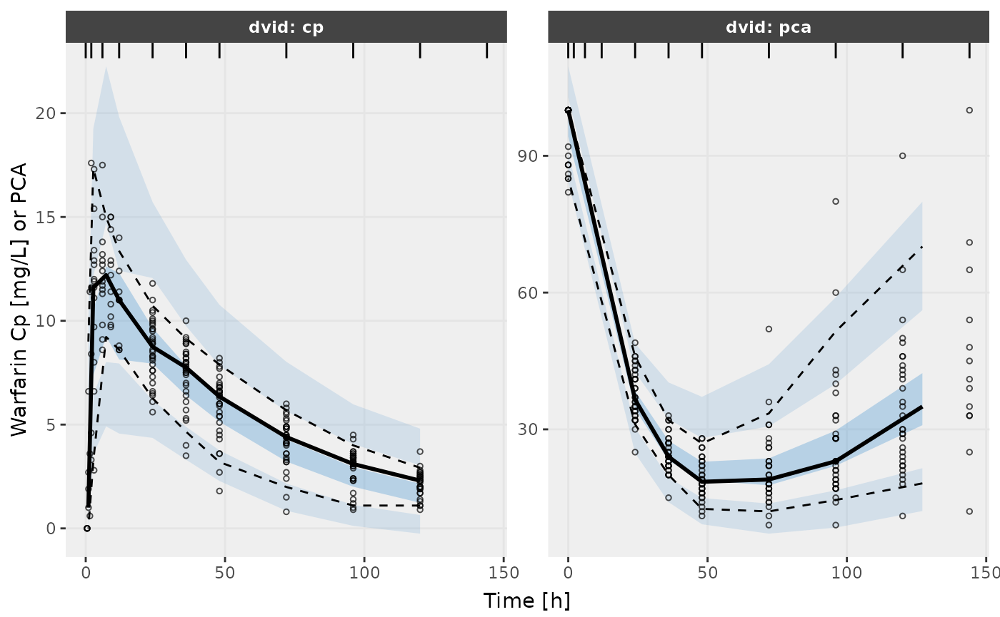
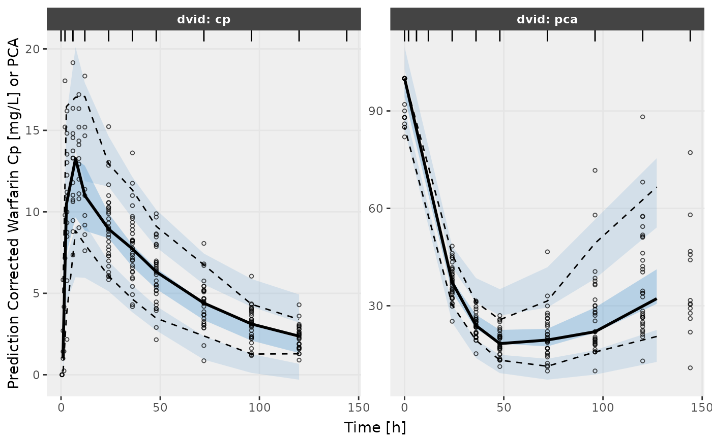

# Running NONMEM with nlmixr2

``` r

library(babelmixr2)
```

## Step 0: What do you need to do to have `nlmixr2` run `NONMEM` from a nlmixr2 model

To use `NONMEM` in nlmixr, you do not need to change your data or your
`nlmixr2` dataset. `babelmixr2` will do the heavy lifting here.

You do need to setup how to run `NONMEM`. For many cases this is easy;
You simply have to figure out the command to run `NONMEM` (it is often
useful to use the full command path). You can set it in
`options("babelmixr2.nonmem"="nmfe743")` or use
`nonmemControl(runCommand="nmfe743")`. I prefer the
[`options()`](https://rdrr.io/r/base/options.html) method since you only
need to set it once. This could also be a function if you prefer (but I
will not cover using the function here).

## Step 1: Run a `nlmixr2` in NONMEM

Lets take the classic warfarin example to start the comparison.

The model we use in the `nlmixr2` vignettes is:

``` r

library(babelmixr2)
pk.turnover.emax3 <- function() {
  ini({
    tktr <- log(1)
    tka <- log(1)
    tcl <- log(0.1)
    tv <- log(10)
    ##
    eta.ktr ~ 1
    eta.ka ~ 1
    eta.cl ~ 2
    eta.v ~ 1
    prop.err <- 0.1
    pkadd.err <- 0.1
    ##
    temax <- logit(0.8)
    tec50 <- log(0.5)
    tkout <- log(0.05)
    te0 <- log(100)
    ##
    eta.emax ~ .5
    eta.ec50  ~ .5
    eta.kout ~ .5
    eta.e0 ~ .5
    ##
    pdadd.err <- 10
  })
  model({
    ktr <- exp(tktr + eta.ktr)
    ka <- exp(tka + eta.ka)
    cl <- exp(tcl + eta.cl)
    v <- exp(tv + eta.v)
    emax = expit(temax+eta.emax)
    ec50 =  exp(tec50 + eta.ec50)
    kout = exp(tkout + eta.kout)
    e0 = exp(te0 + eta.e0)
    ##
    DCP = center/v
    PD=1-emax*DCP/(ec50+DCP)
    ##
    effect(0) = e0
    kin = e0*kout
    ##
    d/dt(depot) = -ktr * depot
    d/dt(gut) =  ktr * depot -ka * gut
    d/dt(center) =  ka * gut - cl / v * center
    d/dt(effect) = kin*PD -kout*effect
    ##
    cp = center / v
    cp ~ prop(prop.err) + add(pkadd.err)
    effect ~ add(pdadd.err) | pca
  })
}
```

Now you can run the `nlmixr2` model using `NONMEM` you simply can run it
directly:

``` r

try(nlmixr(pk.turnover.emax3, nlmixr2data::warfarin, "nonmem",
           nonmemControl(readRounding=FALSE, modelName="pk.turnover.emax3")),
    silent=TRUE)
#> ℹ parameter labels from comments are typically ignored in non-interactive mode
#> ℹ Need to run with the source intact to parse comments
#> → loading into symengine environment...
#> → pruning branches (`if`/`else`) of full model...
#> ✔ done
#> 
#> 
#>  WARNINGS AND ERRORS (IF ANY) FOR PROBLEM    1
#> 
#>  (WARNING  2) NM-TRAN INFERS THAT THE DATA ARE POPULATION.
#> 
#> 
#> 0MINIMIZATION TERMINATED
#>  DUE TO ROUNDING ERRORS (ERROR=134)
#>  NO. OF FUNCTION EVALUATIONS USED:     1088
#>  NO. OF SIG. DIGITS UNREPORTABLE
#> 0PARAMETER ESTIMATE IS NEAR ITS BOUNDARY
#> 
#> nonmem model: 'pk.turnover.emax3-nonmem/pk.turnover.emax3.nmctl'
#> → terminated with rounding errors, can force nlmixr2/rxode2 to read with nonmemControl(readRounding=TRUE)
```

That this is the same way you would run an ordinary `nlmixr2` model, but
it is simply a new estimation method `"nonmem"` with a new controller
([`nonmemControl()`](https://nlmixr2.github.io/babelmixr2/reference/nonmemControl.md))
to setup options for estimation.

A few options in the
[`nonmemControl()`](https://nlmixr2.github.io/babelmixr2/reference/nonmemControl.md)
here is `modelName` which helps control the output directory of `NONMEM`
(if not specified `babelmixr2` tries to guess based on the model name
based on the input).

If you try this yourself, you see that `NONMEM` fails with rounding
errors. You could do the standard approach of changing `sigdig`, `sigl`,
`tol` etc, to get a successful `NONMEM` model convergence, of course
that is supported. But with `babelmixr2` you can *do more*.

## Optional Step 2: Recover a failed NONMEM run

One of the other approaches is to **ignore** the rounding errors that
have occurred and read into `nlmixr2` anyway:

``` r

# Can still load the model to get information (possibly pipe) and create a new model
f <- nlmixr(pk.turnover.emax3, nlmixr2data::warfarin, "nonmem",
            nonmemControl(readRounding=TRUE, modelName="pk.turnover.emax3"))
#> ℹ parameter labels from comments are typically ignored in non-interactive mode
#> ℹ Need to run with the source intact to parse comments
#> → loading into symengine environment...
#> → pruning branches (`if`/`else`) of full model...
#> ✔ done
#> → loading into symengine environment...
#> → pruning branches (`if`/`else`) of full model...
#> ✔ done
#> → finding duplicate expressions in EBE model...
#> → compiling EBE model...
#> ✔ done
#> rxode2 5.1.8.9000 using 2 threads (see ?getRxThreads)
#>   no cache: create with `rxCreateCache()`
#> → Calculating residuals/tables
#> ✔ done
#> → compress origData in nlmixr2 object, save 27816
#> → compress parHistData in nlmixr2 object, save 5040
```

You may see more work happening than you expected to need for an already
completed model. When reading in a NONMEM model, `babelmixr2` grabs:

- `NONMEM`’s objective function value
- `NONMEM`’s covariance (if available)
- `NONMEM`’s optimization history
- `NONMEM`’s final parameter estimates (including the ETAs)
- `NONMEM`’s `PRED` and `IPRED` values (for validation purposes)

These are used to solve the ODEs *as if they came from an nlmixr2*
optimization procedure.

This means that you can compare the `IPRED` and `PRED` values of
`nlmixr2`/`rxode2` and *know immediately* if your model validates.

This is similar to the procedure Kyle Baron advocates for validating a
NONMEM model against a `mrgsolve` model (see
<https://mrgsolve.org/blog/posts/2022-05-validate-translation/> and
<https://mrgsolve.org/blog/posts/2023-update-validation.html>),

The advantage of this method is that you need to simply write one model
to get a validated `roxde2`/`nlmixr2` model.

In this case you can see the validation when you print the fit object:

``` r

print(f)
#> ── nlmixr² nonmem ver 7.4.3 ──
#> 
#>                 OBJF      AIC      BIC Log-likelihood Condition#(Cov)
#> nonmem focei 1326.91 2252.605 2332.025      -1107.302              NA
#>              Condition#(Cor)
#> nonmem focei              NA
#> 
#> ── Time (sec $time): ──
#> 
#>              setup preprocess postprocess table compress NONMEM
#> elapsed 0.07893066      0.058       0.016 0.028    0.011 320.27
#> 
#> ── Population Parameters ($parFixed or $parFixedDf): ──
#> 
#>               Est. SE %RSE Back-transformed(95%CI) BSV(CV% or SD) Shrink(SD)%
#> tktr       6.24e-7                            1.00           86.5       59.8 
#> tka       -3.01e-6                            1.00           86.5       59.8 
#> tcl          -2.00                           0.135           28.6       1.34 
#> tv            2.05                            7.78           22.8       6.44 
#> prop.err    0.0986                          0.0986                           
#> pkadd.err    0.512                           0.512                           
#> temax         6.42                           0.998        0.00707        100 
#> tec50        0.141                            1.15           45.0       6.06 
#> tkout        -2.95                          0.0522           9.16       32.4 
#> te0           4.57                            96.6           5.24       18.1 
#> pdadd.err     3.72                            3.72                           
#>  
#>   No correlations in between subject variability (BSV) matrix
#>   Full BSV covariance ($omega) or correlation ($omegaR; diagonals=SDs) 
#>   Distribution stats (mean/skewness/kurtosis/p-value) available in $shrink 
#>   Information about run found ($runInfo):
#>    • NONMEM terminated due to rounding errors, but reading into nlmixr2/rxode2 anyway 
#>    • omega collapsed (<0.001 x initial): eta.emax 
#>    • high eta shrinkage (>=30%): eta.ktr, eta.ka, eta.emax, eta.kout 
#>   Censoring ($censInformation): No censoring
#>   Minimization message ($message):  
#>     
#> 
#>  WARNINGS AND ERRORS (IF ANY) FOR PROBLEM    1
#> 
#>  (WARNING  2) NM-TRAN INFERS THAT THE DATA ARE POPULATION.
#> 
#>     
#> 0MINIMIZATION TERMINATED
#>  DUE TO ROUNDING ERRORS (ERROR=134)
#>  NO. OF FUNCTION EVALUATIONS USED:     1088
#>  NO. OF SIG. DIGITS UNREPORTABLE
#> 0PARAMETER ESTIMATE IS NEAR ITS BOUNDARY
#> 
#>     IPRED relative difference compared to Nonmem IPRED: 0%; 95% percentile: (0%,0%); rtol=6.42e-06
#>     PRED relative difference compared to Nonmem PRED: 0%; 95% percentile: (0%,0%); rtol=6.08e-06
#>     IPRED absolute difference compared to Nonmem IPRED: 95% percentile: (2.54e-06, 0.000503); atol=7.15e-05
#>     PRED absolute difference compared to Nonmem PRED: 95% percentile: (3.79e-07,0.00311); atol=6.08e-06
#>     there are solving errors during optimization (see '$prderr')
#>     nonmem model: 'pk.turnover.emax3-nonmem/pk.turnover.emax3.nmctl' 
#> 
#> ── Fit Data (object is a modified tibble): ──
#> # A tibble: 483 × 35
#>   ID     TIME CMT      DV  PRED   RES IPRED   IRES  IWRES eta.ktr eta.ka eta.cl
#>   <fct> <dbl> <fct> <dbl> <dbl> <dbl> <dbl>  <dbl>  <dbl>   <dbl>  <dbl>  <dbl>
#> 1 1       0.5 cp      0    1.16 -1.16 0.444 -0.444 -0.864  -0.506 -0.506  0.699
#> 2 1       1   cp      1.9  3.37 -1.47 1.45   0.446  0.840  -0.506 -0.506  0.699
#> 3 1       2   cp      3.3  7.51 -4.21 3.96  -0.660 -1.03   -0.506 -0.506  0.699
#> # ℹ 480 more rows
#> # ℹ 23 more variables: eta.v <dbl>, eta.emax <dbl>, eta.ec50 <dbl>,
#> #   eta.kout <dbl>, eta.e0 <dbl>, cp <dbl>, depot <dbl>, gut <dbl>,
#> #   center <dbl>, effect <dbl>, ktr <dbl>, ka <dbl>, cl <dbl>, v <dbl>,
#> #   emax <dbl>, ec50 <dbl>, kout <dbl>, e0 <dbl>, DCP <dbl>, PD <dbl>,
#> #   kin <dbl>, tad <dbl>, dosenum <dbl>
```

Which shows the `preds` and `ipreds` match between `NONMEM` and
`nlmixr2` quite well.

## Optional Step 3: Use `nlmixr2` to help understand why `NONMEM` failed

Since it *is* a `nlmixr2` fit, you can do interesting things with this
fit that you couldn’t do in `NONMEM` or even in another translator. For
example, if you wanted to add a covariance step you can with
[`getVarCov()`](https://rdrr.io/pkg/nlme/man/getVarCov.html):

``` r

getVarCov(f)
#> → loading into symengine environment...
#> → pruning branches (`if`/`else`) of full model...
#> ✔ done
#> [====|====|====|====|====|====|====|====|====|====] 0:00:00
#> → calculate sensitivities
#> [====|====|====|====|====|====|====|====|====|====] 0:00:00
#> → calculate ∂(f)/∂(η)
#> [====|====|====|====|====|====|====|====|====|====] 0:00:00
#> → finding duplicate expressions in inner model...
#> → finding duplicate expressions in EBE model...
#> → compiling inner model...
#> ✔ done
#> → finding duplicate expressions in FD model...
#> → compiling EBE model...
#> ✔ done
#> → compiling events FD model...
#> ✔ done
#> calculating covariance matrix
#> [====|====|====|====|====|====|====|====|====|====] 0:01:37
#> Warning: "r,s" not usable (sandwich doubtful); installed "r"
#> Warning: "r,s (full)" needs a positive-definite R; using "s (full)"
#> → compress origData in nlmixr2 object, save 27816
#> Updated original fit object f
#>                      tktr           tka           tcl            tv
#> tktr         1.313554e+07 -1.313669e+07 -1.931309e+02  5.451950e+01
#> tka         -1.313669e+07  1.313785e+07  1.931081e+02 -5.448055e+01
#> tcl         -1.931309e+02  1.931081e+02  2.559890e-02 -2.316752e-02
#> tv           5.451950e+01 -5.448055e+01 -2.316752e-02  2.798847e-02
#> prop.err     1.092502e+01 -1.092341e+01 -1.614471e-03  2.319118e-03
#> pkadd.err   -1.927787e+01  1.926854e+01 -2.224642e-03  2.267618e-03
#> temax        5.741308e+03 -5.744139e+03 -7.283272e-01  1.045915e+00
#> tec50       -1.286344e+02  1.286542e+02 -8.626498e-03  1.685571e-02
#> tkout        5.160726e+01 -5.160122e+01 -1.518160e-03  4.543488e-04
#> te0          4.138382e+01 -4.138024e+01 -3.856261e-03  3.984351e-03
#> pdadd.err   -3.985298e+02  3.985417e+02  3.145862e-02 -3.306720e-02
#> om.eta.ktr   1.659591e+07 -1.659698e+07 -5.355384e+02  3.574178e+02
#> om.eta.ka   -1.660791e+07  1.660897e+07  5.358473e+02 -3.575967e+02
#> om.eta.cl    1.793517e+01 -1.792451e+01 -6.907552e-03  7.520048e-03
#> om.eta.v     6.081132e+01 -6.082301e+01  2.969828e-04 -9.228597e-04
#> om.eta.emax -7.949877e+03  7.937149e+03  5.359037e+00 -5.266417e+00
#> om.eta.ec50 -7.890213e+01  7.891290e+01  2.060570e-03 -1.115729e-03
#> om.eta.kout  2.548028e+00 -2.548671e+00  1.071224e-04 -2.128247e-04
#> om.eta.e0    2.553822e+00 -2.553428e+00 -1.716808e-04  1.780046e-04
#>                  prop.err     pkadd.err         temax         tec50
#> tktr         1.092502e+01 -1.927787e+01  5.741308e+03 -1.286344e+02
#> tka         -1.092341e+01  1.926854e+01 -5.744139e+03  1.286542e+02
#> tcl         -1.614471e-03 -2.224642e-03 -7.283272e-01 -8.626498e-03
#> tv           2.319118e-03  2.267618e-03  1.045915e+00  1.685571e-02
#> prop.err     3.624412e-04 -1.322393e-04  1.450938e-01  1.923357e-03
#> pkadd.err   -1.322393e-04  4.481039e-03  5.271218e-01  2.797653e-03
#> temax        1.450938e-01  5.271218e-01  4.632184e+02  2.701156e+00
#> tec50        1.923357e-03  2.797653e-03  2.701156e+00  3.863617e-02
#> tkout       -4.932393e-05 -1.681097e-03 -8.829066e-01 -5.929800e-03
#> te0          3.646469e-04  2.080497e-04  8.484534e-02  1.267070e-03
#> pdadd.err   -2.644508e-03 -6.352102e-03 -3.331044e+00 -3.778865e-02
#> om.eta.ktr   2.028959e+01  4.462122e+01  1.602327e+04  4.494507e+00
#> om.eta.ka   -2.030137e+01 -4.462190e+01 -1.603341e+04 -4.461735e+00
#> om.eta.cl    6.408230e-04  9.280167e-04  3.304835e-01  4.733698e-03
#> om.eta.v    -9.596036e-05  4.991846e-04  1.806680e-01 -7.395424e-04
#> om.eta.emax -5.693932e-01  5.189019e-01 -4.169582e+02 -4.307418e+00
#> om.eta.ec50 -6.172816e-05  9.820112e-05 -3.560844e-01  2.796668e-03
#> om.eta.kout -4.414057e-05  1.061596e-04 -3.143548e-04 -4.288588e-04
#> om.eta.e0    1.637922e-05 -6.749609e-05 -1.602196e-02 -2.218212e-05
#>                     tkout           te0     pdadd.err    om.eta.ktr
#> tktr         5.160726e+01  4.138382e+01 -3.985298e+02  1.659591e+07
#> tka         -5.160122e+01 -4.138024e+01  3.985417e+02 -1.659698e+07
#> tcl         -1.518160e-03 -3.856261e-03  3.145862e-02 -5.355384e+02
#> tv           4.543488e-04  3.984351e-03 -3.306720e-02  3.574178e+02
#> prop.err    -4.932393e-05  3.646469e-04 -2.644508e-03  2.028959e+01
#> pkadd.err   -1.681097e-03  2.080497e-04 -6.352102e-03  4.462122e+01
#> temax       -8.829066e-01  8.484534e-02 -3.331044e+00  1.602327e+04
#> tec50       -5.929800e-03  1.267070e-03 -3.778865e-02  4.494507e+00
#> tkout        3.261654e-03  2.707665e-04  1.977665e-03  6.515695e+01
#> te0          2.707665e-04  1.055396e-03 -4.036171e-03  9.313265e+01
#> pdadd.err    1.977665e-03 -4.036171e-03  1.040044e-01 -9.491943e+02
#> om.eta.ktr   6.515695e+01  9.313265e+01 -9.491943e+02  2.800845e+07
#> om.eta.ka   -6.520989e+01 -9.318392e+01  9.498085e+02 -2.802699e+07
#> om.eta.cl    4.981802e-05  1.021682e-03 -1.090309e-02  1.009383e+02
#> om.eta.v    -3.563783e-04  3.932531e-05 -5.980469e-04  8.402649e+01
#> om.eta.emax  4.445557e-01 -7.885769e-01  6.603191e+00 -5.613287e+04
#> om.eta.ec50 -4.614750e-04 -2.368167e-04  3.590812e-04 -1.334083e+02
#> om.eta.kout -4.122554e-05 -3.195786e-05  9.397150e-05  3.587217e+00
#> om.eta.e0    6.490502e-05  5.728241e-05 -1.065598e-04  3.835523e+00
#>                 om.eta.ka     om.eta.cl      om.eta.v   om.eta.emax
#> tktr        -1.660791e+07  1.793517e+01  6.081132e+01 -7.949877e+03
#> tka          1.660897e+07 -1.792451e+01 -6.082301e+01  7.937149e+03
#> tcl          5.358473e+02 -6.907552e-03  2.969828e-04  5.359037e+00
#> tv          -3.575967e+02  7.520048e-03 -9.228597e-04 -5.266417e+00
#> prop.err    -2.030137e+01  6.408230e-04 -9.596036e-05 -5.693932e-01
#> pkadd.err   -4.462190e+01  9.280167e-04  4.991846e-04  5.189019e-01
#> temax       -1.603341e+04  3.304835e-01  1.806680e-01 -4.169582e+02
#> tec50       -4.461735e+00  4.733698e-03 -7.395424e-04 -4.307418e+00
#> tkout       -6.520989e+01  4.981802e-05 -3.563783e-04  4.445557e-01
#> te0         -9.318392e+01  1.021682e-03  3.932531e-05 -7.885769e-01
#> pdadd.err    9.498085e+02 -1.090309e-02 -5.980469e-04  6.603191e+00
#> om.eta.ktr  -2.802699e+07  1.009383e+02  8.402649e+01 -5.613287e+04
#> om.eta.ka    2.804555e+07 -1.009865e+02 -8.408013e+01  5.616519e+04
#> om.eta.cl   -1.009865e+02  2.867556e-03 -4.742075e-04 -1.805536e+00
#> om.eta.v    -8.408013e+01 -4.742075e-04  1.204980e-03  6.600302e-01
#> om.eta.emax  5.616519e+04 -1.805536e+00  6.600302e-01  5.435898e+03
#> om.eta.ec50  1.335031e+02  3.648359e-04 -1.172744e-03  2.666162e-01
#> om.eta.kout -3.589034e+00 -4.321557e-05  7.844665e-05  7.107824e-02
#> om.eta.e0   -3.838532e+00  2.074275e-05 -2.878677e-05 -3.179075e-02
#>               om.eta.ec50   om.eta.kout     om.eta.e0
#> tktr        -7.890213e+01  2.548028e+00  2.553822e+00
#> tka          7.891290e+01 -2.548671e+00 -2.553428e+00
#> tcl          2.060570e-03  1.071224e-04 -1.716808e-04
#> tv          -1.115729e-03 -2.128247e-04  1.780046e-04
#> prop.err    -6.172816e-05 -4.414057e-05  1.637922e-05
#> pkadd.err    9.820112e-05  1.061596e-04 -6.749609e-05
#> temax       -3.560844e-01 -3.143548e-04 -1.602196e-02
#> tec50        2.796668e-03 -4.288588e-04 -2.218212e-05
#> tkout       -4.614750e-04 -4.122554e-05  6.490502e-05
#> te0         -2.368167e-04 -3.195786e-05  5.728241e-05
#> pdadd.err    3.590812e-04  9.397150e-05 -1.065598e-04
#> om.eta.ktr  -1.334083e+02  3.587217e+00  3.835523e+00
#> om.eta.ka    1.335031e+02 -3.589034e+00 -3.838532e+00
#> om.eta.cl    3.648359e-04 -4.321557e-05  2.074275e-05
#> om.eta.v    -1.172744e-03  7.844665e-05 -2.878677e-05
#> om.eta.emax  2.666162e-01  7.107824e-02 -3.179075e-02
#> om.eta.ec50  8.880918e-03 -1.618907e-04  3.006225e-05
#> om.eta.kout -1.618907e-04  5.065139e-05 -6.961210e-06
#> om.eta.e0    3.006225e-05 -6.961210e-06  8.816996e-06
```

`nlmixr2` is more generous in what constitutes a covariance step. The
`r,s` covariance matrix is the “most” successful covariance step for
`focei`, but the system will fall back to other methods if necessary.

While this covariance matrix is not `r,s`, and should be regarded with
caution, it can still give us some clues on why this things are not
working in `NONMEM`.

When examining the fit, you can see the shrinkage is high for `temax`,
`tktr` and `tka`, so they could be dropped, making things more likely to
converge in `NONMEM`.

## Optional Step 4: Use model piping to get a successful NONMEM run

If we use model piping to remove the parameters, the new run will start
at the last model’s best estimates (saving a bunch of model development
time).

In this case, I specify the output directory `pk.turnover.emax4` with
the control and get the following:

``` r

f2 <- f %>% model(ktr <- exp(tktr)) %>%
  model(ka <- exp(tka)) %>%
  model(emax = expit(temax)) %>%
  nlmixr(data=nlmixr2data::warfarin, est="nonmem",
         control=nonmemControl(readRounding=FALSE,
                               modelName="pk.turnover.emax4"))
#> ! remove between subject variability `eta.ktr`
#> ! remove between subject variability `eta.ka`
#> ! remove between subject variability `eta.emax`
#> → loading into symengine environment...
#> → pruning branches (`if`/`else`) of full model...
#> ✔ done
#> → loading into symengine environment...
#> → pruning branches (`if`/`else`) of full model...
#> ✔ done
#> → finding duplicate expressions in EBE model...
#> → compiling EBE model...
#> ✔ done
#> → Calculating residuals/tables
#> ✔ done
#> → compress origData in nlmixr2 object, save 27816
#> → compress parHistData in nlmixr2 object, save 7528
```

You can see the `NONMEM` run is now successful and validates against the
`rxode2` model below:

``` r

f2
```

``` math
\begin{align*}
{ktr} & = \exp\left({tktr}\right) \\
{ka} & = \exp\left({tka}\right) \\
{cl} & = \exp\left({tcl}+{eta.cl}\right) \\
{v} & = \exp\left({tv}+{eta.v}\right) \\
{emax} & = expit({temax}, {0}, {1}) \\
{ec50} & = \exp\left({tec50}+{eta.ec50}\right) \\
{kout} & = \exp\left({tkout}+{eta.kout}\right) \\
{e0} & = \exp\left({te0}+{eta.e0}\right) \\
{DCP} & = \frac{{center}}{{v}} \\
{PD} & = {1}-\frac{{emax} {\times} {DCP}}{\left({ec50}+{DCP}\right)} \\
effect({0}) & = {e0} \\
{kin} & = {e0} {\times} {kout} \\
\frac{d \: depot}{dt} & = -{ktr} {\times} {depot} \\
\frac{d \: gut}{dt} & = {ktr} {\times} {depot}-{ka} {\times} {gut} \\
\frac{d \: center}{dt} & = {ka} {\times} {gut}-\frac{{cl}}{{v}} {\times} {center} \\
\frac{d \: effect}{dt} & = {kin} {\times} {PD}-{kout} {\times} {effect} \\
{cp} & = \frac{{center}}{{v}} \\
{cp} & \sim prop({prop.err})+add({pkadd.err}) \\
{effect} & \sim add({pdadd.err}){\lor}{pca}
\end{align*}
```

One thing to emphasize: unlike other translators, you will know
immediately if the translation is off because the model will not
validate. Hence you can start this process with confidence - you will
know immediately if something is wrong.

This is related to [converting NONMEM to a nlmixr2
fit](https://nlmixr2.github.io/nonmem2rx/articles/convert-nlmixr2.html).

Since it is a `nlmixr2` object it would be easy to perform a VPC too
(the same is true for NONMEM models):

``` r

v1s <- vpcPlot(f2, show=list(obs_dv=TRUE), scales="free_y") +
  ylab("Warfarin Cp [mg/L] or PCA") +
  xlab("Time [h]")
#> Warning in filter_dv(obs, verbose): No software packages matched for filtering values, not filtering.
#>  Object class: other, data.frame
#>  Available filters: phoenix, nonmem
#> Warning in filter_dv(sim, verbose): No software packages matched for filtering values, not filtering.
#>  Object class: other, nlmixr2vpcSim, data.frame
#>  Available filters: phoenix, nonmem

v2s <- vpcPlot(f2, show=list(obs_dv=TRUE), pred_corr = TRUE, scales="free_y") +
  ylab("Prediction Corrected Warfarin Cp [mg/L] or PCA") +
  xlab("Time [h]")
#> Warning in filter_dv(obs, verbose): No software packages matched for filtering values, not filtering.
#>  Object class: other, data.frame
#>  Available filters: phoenix, nonmem
#> Warning in filter_dv(obs, verbose): No software packages matched for filtering values, not filtering.
#>  Object class: other, nlmixr2vpcSim, data.frame
#>  Available filters: phoenix, nonmem


library()

v1s
```



``` r


v2s
```


